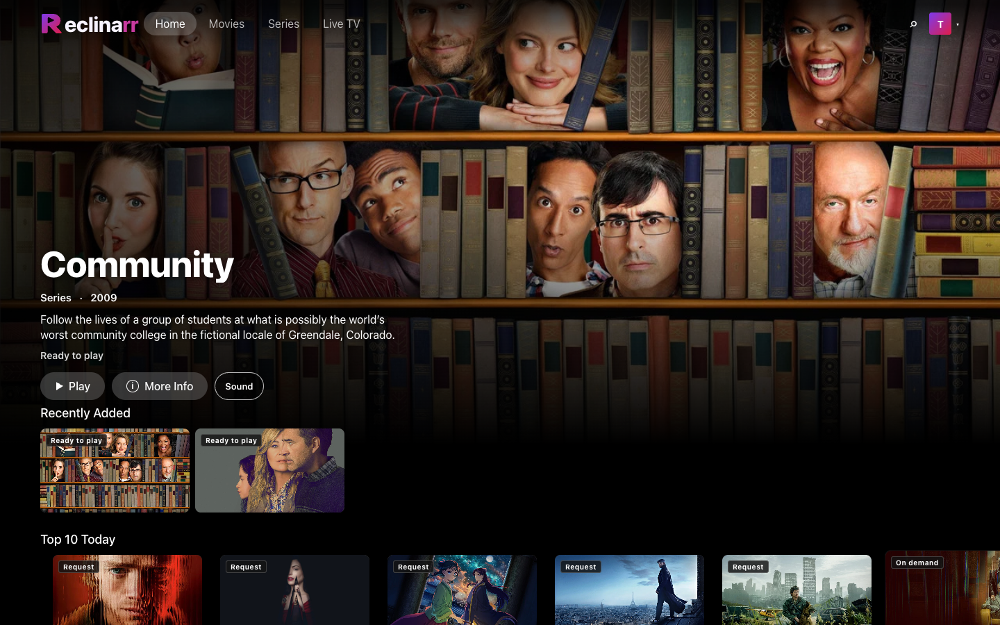
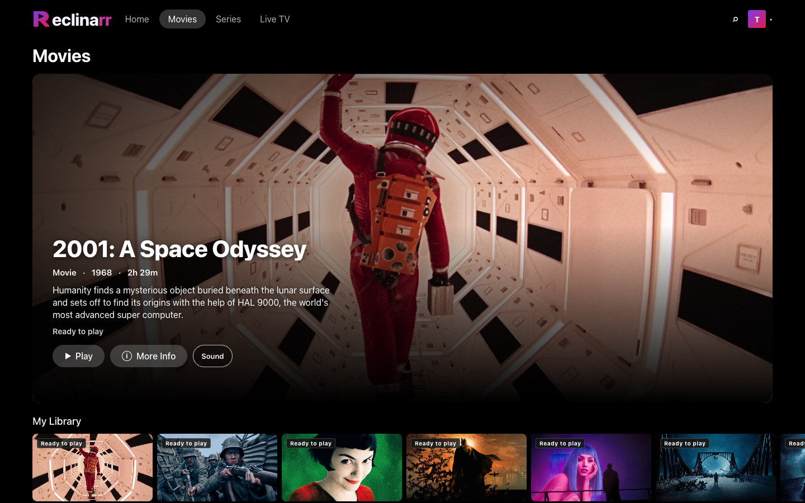
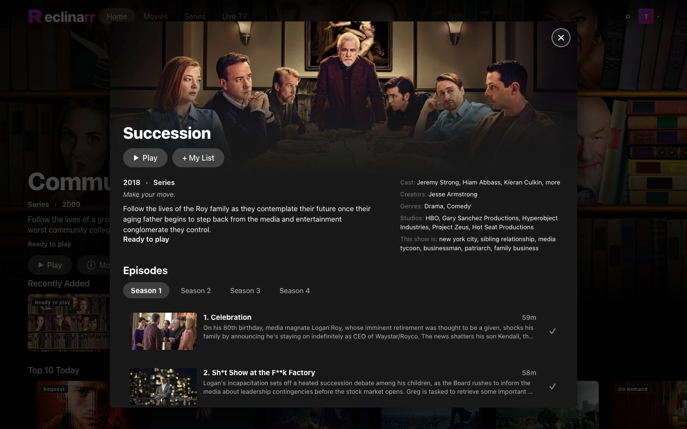
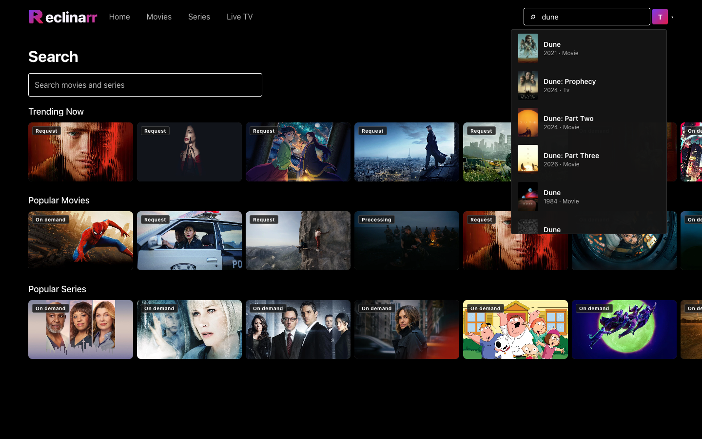
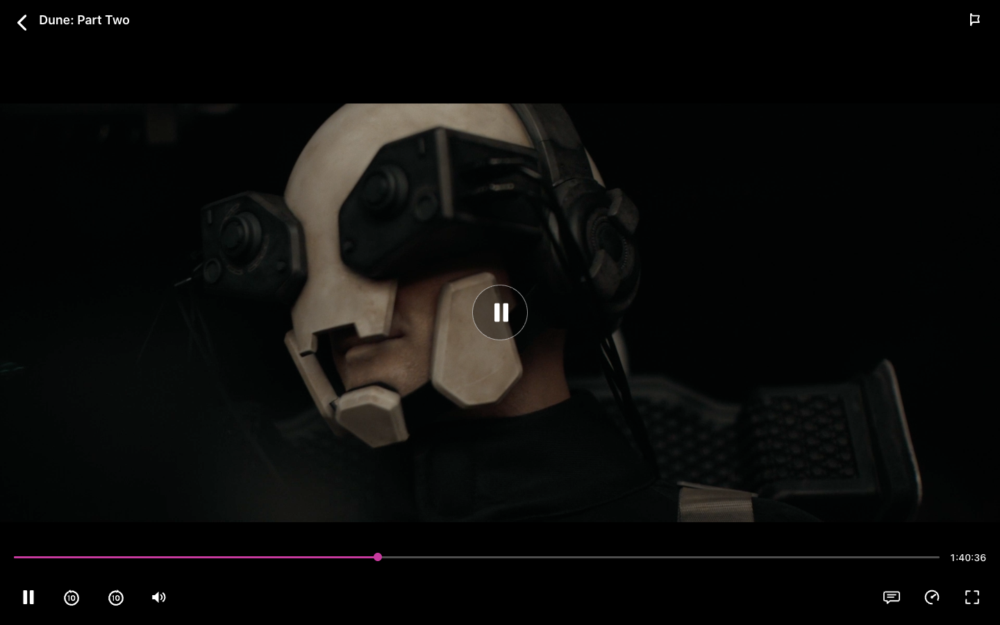

# Reclinarr

[](https://github.com/reclinarr/reclinarr/actions/workflows/ci.yml) [](https://github.com/reclinarr/reclinarr/actions/workflows/codeql.yml)

**Your media. One stream.**

A unified self-hosted streaming application for your movies, series and live TV.

Reclinarr sits on top of **Jellyfin**, **Seerr**, and **Dispatcharr**. It does not replace them. Normal users see one app — not three backends.

```text
                     RECLINARR
                         │
        ┌────────────────┼────────────────┐
        │                │                │
    Jellyfin           Seerr          Dispatcharr
   Library/Play     Discovery/Req      IPTV/Live/VOD
                          │                │
                   Radarr/Sonarr   Reclinarr Acquisition
                                      CACHE / LIBRARY
```

Logo source files are in [`assets/branding`](./assets/branding).

## Screenshots

<p align="center">
  
</p>

<p align="center">
  
</p>

<p align="center">
  
</p>

<p align="center">
  
</p>

<p align="center">
  
</p>

## Current status

**Phases 1–9 are implemented** on a shared React Native UI (`@reclinarr/native-ui`) with Expo web, Android TV, and iOS/Android shells:

| Phase | Status |
|-------|--------|
| 1–7 Product (API + clients) | Done — auth, Jellyfin, Seerr, Dispatcharr, acquisition, live, episodes |
| 8 Android TV | Done — `apps/tv` |
| 9 iOS / Android | Done — `apps/mobile` |
| Web (RN Web) | Done — `apps/web` Expo + `react-native-web` |

See [docs/roadmap.md](./docs/roadmap.md) and [docs/native-unification.md](./docs/native-unification.md).
Opt-in performance metrics are configured in [docs/performance-telemetry.md](./docs/performance-telemetry.md).

## Requirements

- Node.js ≥ 24
- **ffmpeg** / **ffprobe** on `PATH` (or `FFMPEG_PATH`) for the IPTV cache HLS packager
- Docker (optional, for deployment)
- Reachable Jellyfin, Seerr, and Dispatcharr (or `RECLINARR_USE_MOCKS=true`)

## Quick start (development)

```bash
make setup   # npm install + library build
make dev     # API + web + library watchers; Ctrl-C stops everything
```

Configure Jellyfin, Seerr, and Dispatcharr in the setup wizard. Values in a root
`.env` (see `.env.example`) override the wizard, so only copy the keys you need.
`make dev-mock` runs without backends.

Run `make` to list every target.

- Web: http://localhost:5173
- API: http://localhost:8787

## Docker

From a local checkout:

```bash
cp .env.example .env
docker compose --env-file .env -f docker/docker-compose.yml up -d --build
```

Build the image straight from GitHub (Dockerfile at repo root):

```bash
docker build -t reclinarr https://github.com/reclinarr/reclinarr.git
docker run --init --env-file .env -p 8787:8787 -v reclinarr-data:/data reclinarr
```

Or compose with a Git build context, no checkout needed: put [`docker/docker-compose.git.yml`](./docker/docker-compose.git.yml) and a `.env` in one folder and run `docker compose -f docker-compose.git.yml up -d --build` there.

The container runs as uid/gid 1000. If `/data` is a host bind mount owned by someone else, set `PUID`/`PGID` to that owner.

Compose runs **Reclinarr only**. Point env vars at your existing Jellyfin / Seerr / Dispatcharr instances. The Docker image includes **nginx** (media plane), **ffmpeg** (HLS packager), and the API in one container.

Live TV re-encodes H.264 with the GPU when ffmpeg can open one: VideoToolbox when the API runs on macOS, VAAPI for Intel/AMD when `/dev/dri` is visible, and NVENC or Quick Sync when that encoder is in the ffmpeg build. Otherwise it uses libx264. Set `RECLINARR_HWACCEL=off` to force software. Alpine's ffmpeg in the image includes VAAPI, and the image installs the VAAPI drivers. NVENC needs an ffmpeg built with `h264_nvenc` (`FFMPEG_PATH`). Docker on macOS runs a Linux VM, so VideoToolbox applies to a native `npm run dev` API process. On a Linux host, uncomment the `/dev/dri` device mount in the compose file.

Mount `/data/library` (or the `reclinarr-data` volume’s `library/` folder) into Jellyfin as a media library root so **Add to Library** promotions are scanned.

## Configuration

See [`.env.example`](./.env.example).

| Variable | Purpose |
|----------|---------|
| `RECLINARR_PORT` | API listen port |
| `RECLINARR_CACHE_MAX_BYTES` | Max size of CACHE acquisitions (default 50 GiB) |
| `RECLINARR_CACHE_TTL_MS` | Max time an idle CACHE file is kept (default 7 days) |
| `RECLINARR_CACHE_WATCHED_TTL_MS` | Delete a CACHE file this long after it was watched past 95% (default 24 hours). Playing the next episode frees earlier watched episodes immediately |
| `RECLINARR_IPTV_MAX_CONNECTIONS` | Concurrent IPTV upstreams (default 3) |
| `FFMPEG_PATH` | Optional path to ffmpeg (HLS packager) |
| `RECLINARR_HWACCEL` | Live encoder: `auto` (default), `off`, `nvenc`, `qsv`, `vaapi`, `videotoolbox` |
| `RECLINARR_VAAPI_DEVICE` | VAAPI/QSV render node (default: first `/dev/dri/renderD*`) |
| `RECLINARR_MEDIA_PLANE` | `node` (local) or `nginx` (Docker) |
| `PUID` / `PGID` | Docker only: uid/gid the container runs as (default 1000) |
| `RECLINARR_TRUSTED_PROXIES` | Reverse proxies in front of Reclinarr (IPs/CIDRs) trusted for client IPs |
| `JELLYFIN_URL` | Jellyfin base URL |
| `SEERR_URL` / `SEERR_API_KEY` | Seerr |
| `DISPATCHARR_URL` / `DISPATCHARR_API_KEY` | Dispatcharr |

## Integrations

| Backend | Role |
|---------|------|
| [Jellyfin](./docs/upstream/jellyfin.md) | Library, playback, progress, login |
| [Seerr](./docs/upstream/seerr.md) | Discovery & requests |
| [Dispatcharr](./docs/upstream/dispatcharr.md) | IPTV VOD / Live TV |

Architecture: [docs/architecture.md](./docs/architecture.md).

## Contributing

See [CONTRIBUTING.md](./CONTRIBUTING.md) for setup, checks, and pull request
guidelines. Canonical repo: [reclinarr/reclinarr](https://github.com/reclinarr/reclinarr).

## Development

```bash
make build
make check   # typecheck + lint + test
```

Live Dispatcharr ranking checks are opt-in and use the credentials in `.env`:

```bash
make test-live
```

Primary validation targets are web, the iOS Simulator, and the Google TV emulator.
IPTV on-demand playback downloads into the server cache and starts once enough HLS
segments are available; locally ready titles play from Jellyfin or the existing cache.

Run the native Metro servers on separate ports when testing both emulators:

```bash
make mobile        # :8081
make tv            # :8082
make adb-reverse   # adb reverse tcp:8081 tcp:8082
```

`make ios`, `make android` and `make tv-android` build and launch the dev builds.

The TV emulator's default `localhost:8081` now reaches the TV Metro server on
host port 8082, while the iOS Simulator continues to use host port 8081 directly.
If the TV build is configured explicitly for `localhost:8082`, also run
`adb reverse tcp:8082 tcp:8082`.

### UI end-to-end tests

Install Maestro and keep the local API, web server, and relevant Metro server
running. Sign in on the iOS Simulator and Google TV emulator before running
their flows. The signed-in account needs at least one Continue Watching series
with a playable Mr. Robot S4E1 episode from the configured Jellyfin or IPTV
provider. Live TV is not included because the IPTV provider allows only one
active connection.

Run each platform suite with:

```bash
make e2e-web
make e2e-ios UDID=<IOS_SIMULATOR_UDID>
make e2e-tv UDID=<TV_EMULATOR_UDID>
```

The web flow signs in using `RECLINARR_TEST_USERNAME` and
`RECLINARR_TEST_PASSWORD`; `RECLINARR_WEB_URL` defaults to
`http://localhost:5173`. Set those variables in the shell before running the
web suite. Native suites reuse the emulator's signed-in app session and exercise
series details plus VOD startup/recovery. Maestro screenshots and failure
artifacts are written to its test output directory.

Monorepo workspaces: `apps/web`, `apps/tv`, `apps/mobile`, `apps/api`, `packages/shared`, `packages/client`, `packages/providers`, `packages/native-ui`, `packages/player-web`.

## License

MIT
